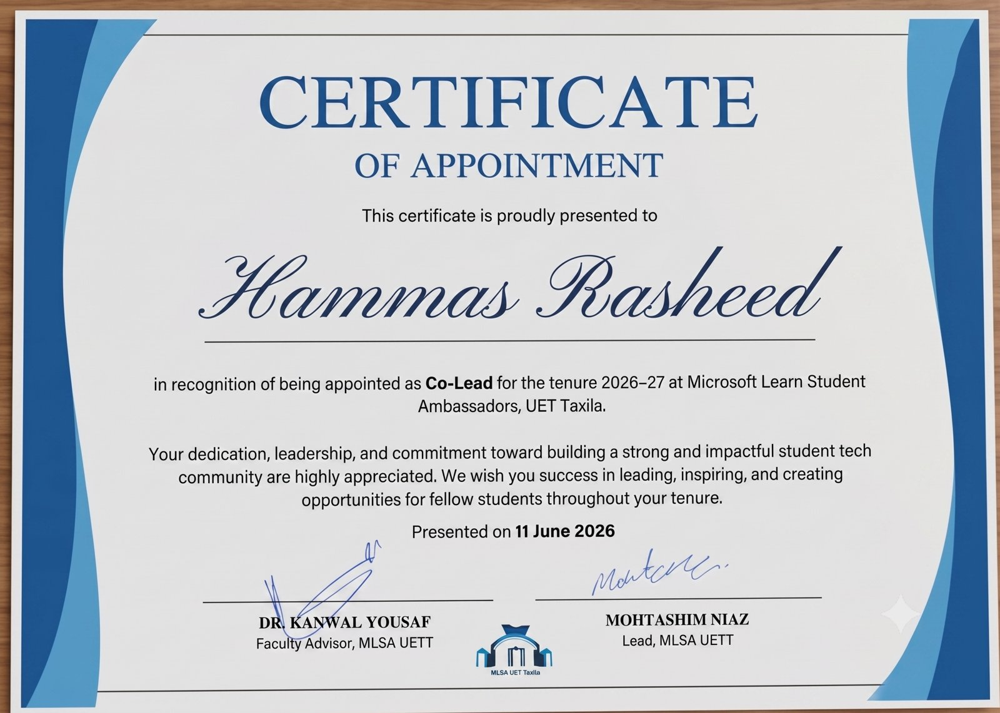

  

  <a href="#me"><b>Me</b></a> • <a href="#journey"><b>Journey</b></a> • <a href="#now"><b>Now</b></a> • <a href="#auraf"><b>AURAF</b></a> • <a href="#arsenal"><b>Arsenal</b></a> • <a href="#philosophy"><b>Philosophy</b></a> • <a href="#projects"><b>Projects</b></a> • <a href="#showcase"><b>Showcase</b></a> • <a href="#roles"><b>Leadership</b></a> • <a href="#certifications"><b>Certifications</b></a> • <a href="#services"><b>Services</b></a> • <a href="#casestudies"><b>Case Studies</b></a> • <a href="#faq"><b>FAQ</b></a> • <a href="#beyond"><b>Beyond Code</b></a> • <a href="#stats"><b>Stats</b></a> • <a href="#wanna-chat"><b>Contact</b></a>

  

<h1 align="center">
  
</h1>

  

  
  
  

<h6 align="center">█████████████████████████████████████████████████████████</h6>

## 👤 The Developer Profile

<table align="center" width="100%">
  <tr>
    <td width="60%" valign="top">
      <h3>🚀 Hello World!</h3>
      
I am a passionate software creator focused on engineering high-fidelity mobile experiences and robust digital architectures. Obsessed with code aesthetics, clean lifecycles, and solving complex problems from the ground up.

      <table>
        <tr><td>🔎&nbsp;<b>Identity</b></td><td></td></tr>
        <tr><td>🎂&nbsp;<b>Age</b></td><td></td></tr>
        <tr><td>🗺️&nbsp;<b>Origin</b></td><td></td></tr>
        <tr><td>🎓&nbsp;<b>Education</b></td><td></td></tr>
        <tr><td>🗣️&nbsp;<b>Languages</b></td><td></td></tr>
        <tr><td>💻&nbsp;<b>Core Stack</b></td><td></td></tr>
        <tr><td>🎯&nbsp;<b>Focus</b></td><td></td></tr>
      </table>
    </td>
    <td width="40%" align="center" valign="middle">
      
    </td>
  </tr>
</table>

I'm **Muhammad Hammas Rasheed**, a Computer Science undergraduate at **UET Taxila**, a **Flutter Developer** with two years of experience, and a **Figma UI/UX designer**. I build production-style apps for **Android and iOS** from one codebase using **Clean Architecture, Riverpod and BLoC**, and I hand-build my animations instead of leaning on animation libraries. On the backend I work with **Firebase, Supabase, SQLite and REST APIs**, so I can take a smaller app from design all the way to the store.

- 📱 **Mobile:** Production-ready Flutter apps with clean layers, real backends and smooth motion.
- 🎨 **Design:** Figma and Moqups designs turned into pixel-accurate, animated Flutter UI.
- 🔬 **Research:** On-device AI, adaptive runtimes and mobile performance (see AURAF below).
- 📦 **Open source:** Published Flutter packages for animation and layout safety.
- 💬 **Ask me about:** Flutter architecture, custom animations, Riverpod, FlutterFlow, or mobile AI.
- ✉️ **Contact:** [23-CS-98@students.uettaxila.edu.pk](mailto:23-CS-98@students.uettaxila.edu.pk)

<blockquote align="center">
💡 <b>Fun Fact:</b> I've been breaking (and successfully fixing) production systems and computational code since I was 13!
</blockquote>

<h6 align="center">█████████████████████████████████████████████████████████</h6>

## 🗺️ My Journey

<table align="center" width="100%">
  <tr>
    <td width="20%" align="center" valign="top">
        
      
Got admitted into BS Computer Science and wrote my very first program.

    </td>
    <td width="20%" align="center" valign="top">
        
      
Fell in love with Flutter and shipped my first cross-platform app soon after.

    </td>
    <td width="20%" align="center" valign="top">
        
      
Rebuilt Starbucks, Ben 10, and Pac-Man in Flutter to master animation and architecture.

    </td>
    <td width="20%" align="center" valign="top">
        
      
Took on Co-Lead, CSP Head, and Senior Executive roles across university societies.

    </td>
    <td width="20%" align="center" valign="top">
        
      
Focused on production-ready apps, mentoring, freelance clients, and my AURAF final year research project.

    </td>
  </tr>
</table>

<h6 align="center">█████████████████████████████████████████████████████████</h6>

## 🔭 Right Now

<table align="center" width="100%">
  <tr>
    <td width="25%" align="center" valign="top">
        
      
Production-grade Flutter apps with Clean Architecture and real backend integrations, plus the AURAF research packages.

    </td>
    <td width="25%" align="center" valign="top">
        
      
Advanced C++ systems programming, deeper backend/API design patterns, and on-device LLM inference.

    </td>
    <td width="25%" align="center" valign="top">
        
      
Freelance Flutter contracts, remote collaborations, and long-term opportunities.

    </td>
    <td width="25%" align="center" valign="top">
        
      
Actively shipping and available for new projects.

    </td>
  </tr>
</table>

<h6 align="center">█████████████████████████████████████████████████████████</h6>

## 🔬 Research Project: AURAF

**AURAF (Adaptive Unified Runtime Architecture for Flutter)** is my final year research project at UET Taxila, built with Muhammad Assad Ullah. It is a family of four Dart packages that decide, for every AI request in a Flutter app, where it runs (cloud or phone), how much context it carries, and how the on-device model is configured. The unifying package makes all three decisions together from live battery, network, thermal, memory and cost data, using a lightweight drift-plus-penalty policy that is tested against baselines on real Android phones.

<table width="100%">
  <tr>
    <td width="30%" align="center">
      
    </td>
    <td width="70%">
      Counts tokens and trims the conversation to a context budget, with cost estimates per provider.  
      
      
    </td>
  </tr>
  <tr>
    <td width="30%" align="center">
      
    </td>
    <td width="70%">
      Routes each request to the cloud or the device and fails over when the connection drops.  
      
    </td>
  </tr>
  <tr>
    <td width="30%" align="center">
      
    </td>
    <td width="70%">
      Applies the chosen on-device model, quantization level, thread count and accelerator.  
      
    </td>
  </tr>
  <tr>
    <td width="30%" align="center">
      
    </td>
    <td width="70%">
      Unifies the three behind one API with a State Collector and a Decision Engine that picks the best action under energy and quality constraints.  
      
      
    </td>
  </tr>
</table>

<i>My part: literature survey, model and runtime comparison, State Collector, token_guard, automated tests, example apps, CI and the reports.</i>

<h6 align="center">█████████████████████████████████████████████████████████</h6>

## 🧰 Tech Arsenal

<table align="center" width="100%">
  <tr>
    <td align="center" width="100%">
      <b>📱 LANGUAGES & MOBILE</b>  
      
    </td>
  </tr>
  <tr><td> </td></tr>
  <tr>
    <td align="center" width="100%">
      <b>🗄️ BACKEND & DATA</b>  
      
    </td>
  </tr>
  <tr><td> </td></tr>
  <tr>
    <td align="center" width="100%">
      <b>🛠️ TOOLS & ENVIRONMENTS</b>  
      
    </td>
  </tr>
  <tr><td> </td></tr>
  <tr>
    <td align="center" width="100%">
      <b>🎨 DESIGN & IDE</b>  
      
    </td>
  </tr>
</table>

 

<table align="center" width="100%">
  <tr>
    <td width="50%" align="center" valign="top">
      <h4>📈 Code Ecosystem</h4>
        
        
      
    </td>
    <td width="50%" align="center" valign="top">
      <h4>💻 Primary Code Stack</h4>
        
        
      
    </td>
  </tr>
</table>

 

### 🛠️ Technical Skills

**Languages** 

**Mobile & Architecture** 

**Backend & Data** 

**Design** 

**Tools & DevOps** 

<h6 align="center">█████████████████████████████████████████████████████████</h6>

## 🧭 How I Work

<table align="center" width="100%">
  <tr>
    <td width="25%" align="center" valign="top">
        
      
Every feature lives in its own layer — no tangled logic, no surprises six months later.

    </td>
    <td width="25%" align="center" valign="top">
        
      
A security researcher's instinct: assume nothing is safe until it's tested.

    </td>
    <td width="25%" align="center" valign="top">
        
      
Pixel-level care in UI, because how an app feels matters as much as how it runs.

    </td>
    <td width="25%" align="center" valign="top">
        
      
Mentoring juniors and leading student communities isn't a side note — it's core to how I grow.

    </td>
  </tr>
</table>

<h6 align="center">█████████████████████████████████████████████████████████</h6>

## ⚡ Featured Creations

<table width="100%">
  <tr>
    <td width="30%" align="center">
      
    </td>
    <td width="70%">
      A published open-source Flutter package for gesture-driven, physics-based animations, built so other developers can drop smooth motion into their own apps.  
      
      
        
      
    </td>
  </tr>
  <tr>
    <td width="30%" align="center">
      
    </td>
    <td width="70%">
      A published open-source Flutter package that keeps flex layouts safe from overflow errors, so UIs stay stable on any screen size.  
      
      
        
      
    </td>
  </tr>
  <tr>
    <td width="30%" align="center">
      
    </td>
    <td width="70%">
      A feature-rich Starbucks mobile app UI replica built with Flutter, showcasing custom product menus, seamless ordering flows, and polished styling.  
      
        
      
    </td>
  </tr>
  <tr>
    <td width="30%" align="center">
      
    </td>
    <td width="70%">
      An interactive Omnitrix watch interface crafted in Flutter featuring nostalgic animations, custom rotating UI mechanics, and dynamic states.  
      
        
      
    </td>
  </tr>
  <tr>
    <td width="30%" align="center">
      
    </td>
    <td width="70%">
      A fully functional clone of the classic arcade game Pac-Man built from scratch using Flutter with custom grid rendering and game loops.  
      
        
      
    </td>
  </tr>
</table>

<h6 align="center">█████████████████████████████████████████████████████████</h6>

## 🎬 App Showcase

  

<table align="center" width="100%">
  <tr>
    <td align="center" width="25%">
       
      <b>Live Preview</b>
    </td>
    <td align="center" width="25%">
       
      <b>Home Screen</b>
    </td>
    <td align="center" width="25%">
       
      <b>Selection State</b>
    </td>
    <td align="center" width="25%">
       
      <b>Product Details</b>
    </td>
  </tr>
</table>

 

  

<table align="center" width="100%">
  <tr>
    <td align="center" width="33%">
       
      <b>Live Preview</b>
    </td>
    <td align="center" width="33%">
       
      <b>Main Screen</b>
    </td>
    <td align="center" width="33%">
       
      <b>Menu Screen</b>
    </td>
  </tr>
</table>

 

  

<table align="center" width="100%">
  <tr>
    <td align="center" width="25%">
       
      <b>Live Preview</b>
    </td>
    <td align="center" width="25%">
       
      <b>Bottle Carousel</b>
    </td>
    <td align="center" width="25%">
       
      <b>Pour in Motion</b>
    </td>
    <td align="center" width="25%">
       
      <b>Fill Screen</b>
    </td>
  </tr>
</table>

<h6 align="center">█████████████████████████████████████████████████████████</h6>

## 🏛️ University Leadership & Society Roles

Stepping up to empower my community, manage technical systems, and drive social impact across various societies at **UET Taxila**:

<table width="100%">
  <tr>
    <td width="20%" align="center" valign="middle">
      
    </td>
    <td width="80%" valign="middle">
        
      
Spearheading the core tech community at UET Taxila, driving technical engagement, bootcamps, and building a collaborative culture around Microsoft's ecosystem.

    </td>
  </tr>
  <tr>
    <td width="20%" align="center" valign="middle">
      
    </td>
    <td width="80%" valign="middle">
        
      
Directing impactful welfare campaigns making education accessible to underserved children, managing resource allocation and sponsor networks.

    </td>
  </tr>
  <tr>
    <td width="20%" align="center" valign="middle">
      
    </td>
    <td width="80%" valign="middle">
        
      
Guiding complex projects, mentoring junior developers in mobile app and system development, and organizing competitive hackathons.

    </td>
  </tr>
  <tr>
    <td width="20%" align="center" valign="middle">
      
    </td>
    <td width="80%" valign="middle">
        
      
Capturing the campus narrative, leading visual media coverage for large-scale symposia, and collaborating on digital asset creation.

    </td>
  </tr>
  <tr>
    <td width="20%" align="center" valign="middle">
      
    </td>
    <td width="80%" valign="middle">
        
      
Managed organizational pipelines and public welfare distributions for the Taxila Chapter, leading cross-functional student assistance drives.

    </td>
  </tr>
</table>

<h6 align="center">█████████████████████████████████████████████████████████</h6>

## 📜 Verified Certifications

<table width="100%">
  <tr>
    <td width="65%" valign="middle">
        
        
      
Verification of advanced proficiency in modern DevOps practices, platform security, and CI/CD pipelines.

      
    </td>
    <td width="35%" align="center" valign="middle">
      
    </td>
  </tr>
  <tr><td colspan="2"> </td></tr>
  <tr>
    <td width="65%" valign="middle">
        
        
      
Validation of expertise in distributed version control workflows, repository management, and conflict resolution.

      
    </td>
    <td width="35%" align="center" valign="middle">
      
    </td>
  </tr>
  <tr><td colspan="2"> </td></tr>
  <tr>
    <td width="65%" valign="middle">
        
        
      
Intensive project on wireframing, low-to-high fidelity interactive mockups, and mobile UX architecture.

      
    </td>
    <td width="35%" align="center" valign="middle">
      
    </td>
  </tr>
  <tr><td colspan="2"> </td></tr>
  <tr>
    <td width="65%" valign="middle">
        
        
      
Foundational course covering Flutter widgets, Dart syntax, and building the first cross-platform mobile UI.

      
    </td>
    <td width="35%" align="center" valign="middle">
      
    </td>
  </tr>
  <tr><td colspan="2"> </td></tr>
  <tr>
    <td width="65%" valign="middle">
        
        
      
In-depth training on advanced UI composition and state management patterns (Provider/BLoC/Riverpod) in Flutter.

      
    </td>
    <td width="35%" align="center" valign="middle">
      
    </td>
  </tr>
  <tr><td colspan="2"> </td></tr>
  <tr>
    <td width="65%" valign="middle">
        
        
      
Introductory course on core mobile app development concepts, cross-platform frameworks, and app design fundamentals.

      
    </td>
    <td width="35%" align="center" valign="middle">
      
    </td>
  </tr>
</table>

<h6 align="center">█████████████████████████████████████████████████████████</h6>

## 🤝 What I Can Build For You

<table width="100%" align="center">
  <tr>
    <td width="25%" align="center" valign="top">
        
      
End-to-end Flutter apps for iOS & Android from a single codebase, ready for the Play Store and App Store.

    </td>
    <td width="25%" align="center" valign="top">
        
      
Firebase, Supabase, and REST API integrations with clean, testable data layers.

    </td>
    <td width="25%" align="center" valign="top">
        
      
Turning Figma or Moqups designs into pixel-perfect, animated Flutter interfaces.

    </td>
    <td width="25%" align="center" valign="top">
        
      
Refactoring, bug fixes, and performance tuning for existing Flutter codebases.

    </td>
  </tr>
</table>

<i>Open to freelance contracts, collaborations, and long-term remote roles.</i>

<h6 align="center">█████████████████████████████████████████████████████████</h6>

## 📈 Case Studies

<table width="100%">
  <tr>
    <td width="100%">
        
      <table width="100%">
        <tr>
          <td width="33%" valign="top">
              
            
Recreate the iconic Omnitrix interface — rotating dial, hologram-style character selection, and glow effects — as a fully interactive Flutter widget instead of a static image.

          </td>
          <td width="33%" valign="top">
              
            
Built custom rotation controllers and gesture detectors from scratch, layered animated transforms for the hologram effect, and kept state isolated per-character for smooth switching.

          </td>
          <td width="33%" valign="top">
              
            
A fluid, nostalgia-driven UI that demonstrates advanced custom animation work — the kind of polish clients want for branded, character-driven app experiences.

          </td>
        </tr>
      </table>
      
    </td>
  </tr>
</table>

 

<table width="100%">
  <tr>
    <td width="100%">
        
      <table width="100%">
        <tr>
          <td width="33%" valign="top">
              
            
Users needed a fast, clean way to check live COVID-19 case data by country without digging through cluttered news dashboards.

          </td>
          <td width="33%" valign="top">
              
            
Consumed a public health API, built a searchable country list, and visualized confirmed/recovered/death stats with clear, glanceable charts.

          </td>
          <td width="33%" valign="top">
              
            
A lightweight, data-driven Flutter app proving I can take a real-world API and turn it into an app that's genuinely usable under pressure.

          </td>
        </tr>
      </table>
    </td>
  </tr>
</table>

 

<table width="100%">
  <tr>
    <td width="100%">
        
      <table width="100%">
        <tr>
          <td width="33%" valign="top">
              
            
Static space-facts pages don't help people intuitively grasp orbital motion, scale, or how the planets relate to each other.

          </td>
          <td width="33%" valign="top">
              
            
Built custom animated orbit paths and layered transforms to simulate planetary motion in real time, then deployed it as a live interactive web build.

          </td>
          <td width="33%" valign="top">
              
            
A live, shareable demo that shows both custom animation skill and the ability to ship a Flutter project to the web.

          </td>
        </tr>
      </table>
      
      
    </td>
  </tr>
</table>

 

<table width="100%">
  <tr>
    <td width="100%">
        
      <table width="100%">
        <tr>
          <td width="33%" valign="top">
              
            
Most food-ordering menus are flat lists — tap, add, checkout. Nothing about the interaction makes the product feel worth ordering.

          </td>
          <td width="33%" valign="top">
              
            
Built a Hero-flight detail screen with a drag-to-rotate, perspective-transformed "3D" pizza viewer, elastic size transitions, and a sequenced reveal — all using Flutter's native animation APIs, no third-party animation packages, on a clean domain/data/presentation architecture with Riverpod.

          </td>
          <td width="33%" valign="top">
              
            
A production-style ordering flow that feels tactile and premium — proof I can hand-build complex motion design instead of leaning on animation libraries, with a repository layer ready to swap in a real backend.

          </td>
        </tr>
      </table>
      
    </td>
  </tr>
</table>

 

<table width="100%">
  <tr>
    <td width="100%">
        
      <table width="100%">
        <tr>
          <td width="33%" valign="top">
              
            
A drink-selection screen is usually just a static list — it doesn't sell the product the way a real cold-drink ad does.

          </td>
          <td width="33%" valign="top">
              
            
Built a swipeable bottle carousel, a tilt-to-pour animation with real fill math (volume relative to cup capacity), a custom-painted liquid surface with a sine-wave top, and a full-screen color wash with ambient bubbles — all state-driven through a single Riverpod StateNotifier.

          </td>
          <td width="33%" valign="top">
              
            
A genuinely ad-quality micro-experience with custom rendering (CustomPainter, CustomClipper) and haptic feedback — the kind of polish that makes a client's product screen memorable instead of forgettable.

          </td>
        </tr>
      </table>
      
    </td>
  </tr>
</table>

<h6 align="center">█████████████████████████████████████████████████████████</h6>

## ❓ FAQ for Clients

<table width="100%">
  <tr>
    <td width="100%">
        
      
iOS and Android from a single Flutter codebase — and web or desktop too, if your project needs it.

    </td>
  </tr>
  <tr>
    <td width="100%">
        
      
Yes — Firebase, Supabase, and REST API integrations are all part of what I offer, so you don't need a separate backend developer for smaller apps.

    </td>
  </tr>
  <tr>
    <td width="100%">
        
      
Depends on scope — a simple single-screen app can take 1-2 weeks, while a full-featured production app usually runs 4-8 weeks. I'll give you a clear timeline after understanding your requirements.

    </td>
  </tr>
  <tr>
    <td width="100%">
        
      
Absolutely. I'm happy to sign an NDA before we discuss any project details.

    </td>
  </tr>
  <tr>
    <td width="100%">
        
      
Yes — bug fixes, small updates, and ongoing maintenance packages are available after delivery.

    </td>
  </tr>
  <tr>
    <td width="100%">
        
      
Discovery call → scope & wireframes → development sprints with regular check-ins → testing → deployment → handover and support.

    </td>
  </tr>
</table>

<h6 align="center">█████████████████████████████████████████████████████████</h6>

## 🎮 Beyond the Code

<table align="center" width="100%">
  <tr>
    <td width="25%" align="center" valign="top">
        
      
Rebuilding childhood favorites like Pac-Man and Ben 10's Omnitrix from scratch, just to see how they tick.

    </td>
    <td width="25%" align="center" valign="top">
        
      
Poking at systems to find and responsibly report vulnerabilities before the bad guys do.

    </td>
    <td width="25%" align="center" valign="top">
        
      
Living in the terminal, customizing workflows, and always chasing a cleaner setup.

    </td>
    <td width="25%" align="center" valign="top">
        
      
Organizing bootcamps and hackathons that turn students into builders.

    </td>
  </tr>
</table>

<h6 align="center">█████████████████████████████████████████████████████████</h6>

## 📊 Activity & Metrics

  

<!-- Contribution activity graph (theme sensitive) -->

  <picture>
    <source media="(prefers-color-scheme: dark)" srcset="https://activity-graph.vercel.app/graph?username=HammasT1&bg_color=0D1B2A&color=94A3B8&line=14B8A6&point=2DD4BF&area_color=0F766E&area=true&hide_border=true&radius=12">
    <source media="(prefers-color-scheme: light)" srcset="https://activity-graph.vercel.app/graph?username=HammasT1&bg_color=FFFFFF&color=475569&line=0D9488&point=14B8A6&area_color=CCFBF1&area=true&hide_border=true&radius=12">
    
  </picture>

<!-- Side-by-side stats cards (theme sensitive) -->

  <picture>
    <source media="(prefers-color-scheme: dark)" srcset="https://ghstats.dev/api/card?username=HammasT1&bg=0D1B2A&title_color=14B8A6&text=94A3B8&icon_color=2DD4BF&border_color=0F766E">
    <source media="(prefers-color-scheme: light)" srcset="https://ghstats.dev/api/card?username=HammasT1&bg=FFFFFF&title_color=0D9488&text=475569&icon_color=14B8A6&border_color=E2E8F0">
    
  </picture>
  <picture>
    <source media="(prefers-color-scheme: dark)" srcset="https://ghstats.dev/api/langs?username=HammasT1&layout=grid&bg=0D1B2A&title_color=14B8A6&text=94A3B8&icon_color=2DD4BF&border_color=0F766E">
    <source media="(prefers-color-scheme: light)" srcset="https://ghstats.dev/api/langs?username=HammasT1&layout=grid&bg=FFFFFF&title_color=0D9488&text=475569&icon_color=14B8A6&border_color=E2E8F0">
    
  </picture>

  

<h6 align="center">█████████████████████████████████████████████████████████</h6>

## 🎯 Progress Tracker

<table width="100%">

  <tr>
    <td width="50%" align="center" valign="top">
      <h3>🚀 Completed Milestones</h3>
        
        
        
        
      
    </td>
    <td width="50%" align="center" valign="top">
      <h3>⚡ Upcoming Goals</h3>
        
        
        
      
    </td>
  </tr>
</table>

<h6 align="center">█████████████████████████████████████████████████████████</h6>

## 🔗 Let's Connect

  Open to freelance work, collaborations, and full-time opportunities. 
  Reach out and let's build something great together.

  

  

  

  <i>"Building the Future, One Widget at a Time."</i>

  ⭐ <b>If you like this profile README, please consider leaving a star to show your support!</b> ⭐

  

 

  

